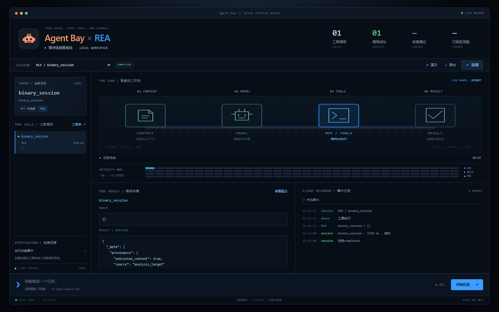
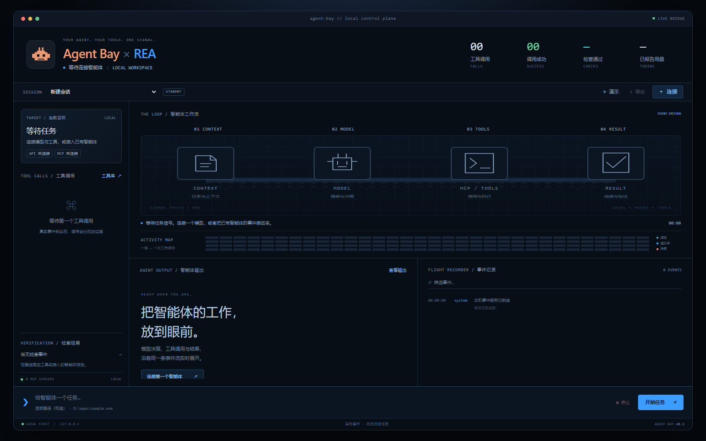
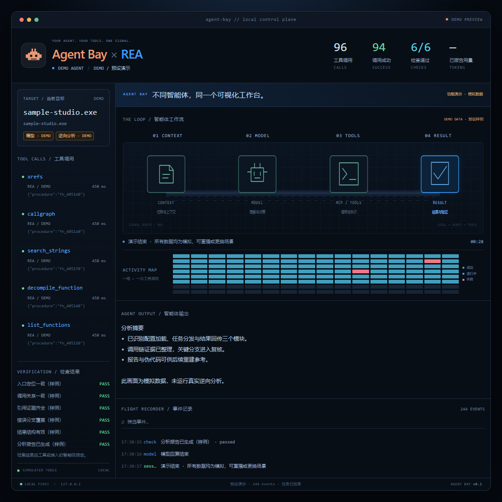
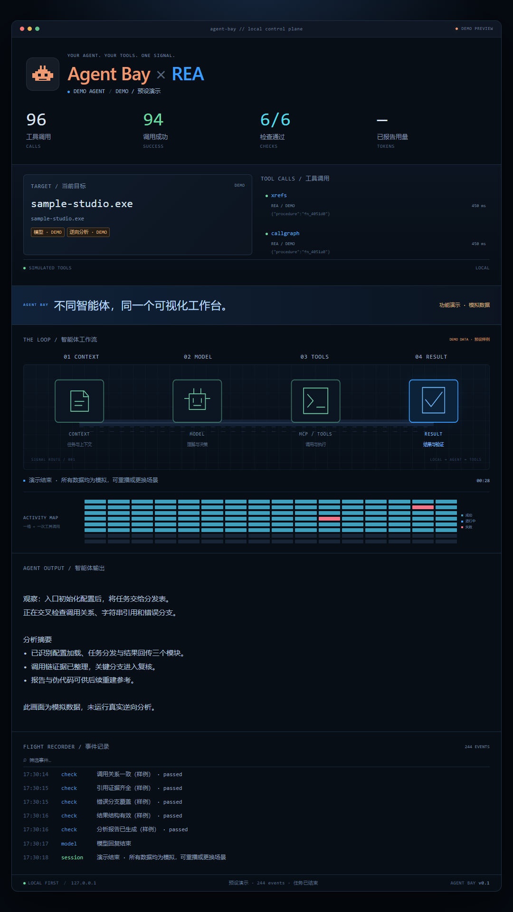
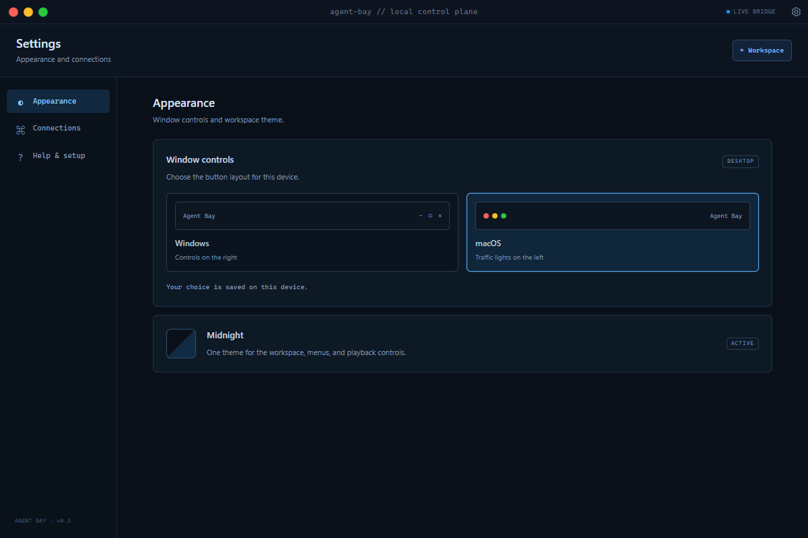

# Agent Bay

**English** | [&#x4E2D;&#x6587;](README.zh-CN.md)

A local terminal-style dashboard for live model output, tool calls, analysis results, and task status. Runs on Windows, macOS, and Linux, with model APIs, MCP tools, and external agents.

## Screenshots



| Standby workspace | Square demo | Portrait demo | Appearance settings |
| --- | --- | --- | --- |
|  |  |  |  |

## Demo video

<video src="docs/media/agent-bay-cleanroom-square-24.8s-30fps.mp4" poster="docs/media/agent-bay-cleanroom-square-24.8s-30fps-cover.png" controls muted width="540"></video>

[Play the clean-room demo](docs/media/agent-bay-cleanroom-square-24.8s-30fps.mp4) — 24.8 s at 30 fps, square 1080×1080, no audio. All data is simulated; see [Promotional previews](#promotional-previews) to run it live.

## Start

Use Node.js 24.x, version 24.11 or later. On any supported operating system:

```sh
cd /path/to/agent-bay
npm install
npm start
```

Open http://127.0.0.1:4318. Press Ctrl+C to stop. On macOS or Linux, choose another port with `PORT=4319 npm start`.

On Windows, you can also double-click `start.cmd` or run:

```powershell
cd D:\src\dodoaling\code\agent-bay
.\start.ps1
```

The Windows launcher installs missing dependencies and uses NVM_SYMLINK when configured. Use `./start.ps1 -Port 4319` if the default port is occupied. The application requires Node 22.19 or later; REA and its analysis engines have their own requirements.

## Desktop app

The desktop version uses a Tauri 2 window and a bundled Node.js sidecar to run the same dashboard and local backend. It starts its own loopback server on an automatically assigned port and opens that address inside the app. Existing browser-mode services and their sessions are independent; `npm start` remains available.

The window starts centered at 1200 × 800 logical pixels, capped at 90% of the primary display's available work area. Display scaling and space reserved for the taskbar or dock are included. On smaller displays, the minimum size also adjusts so the window stays within the available space.

The frameless window uses a titlebar that matches the dashboard. Open **Settings → Appearance** and click the **Windows** or **macOS** choice card to switch immediately between controls on the right and traffic lights on the left. The initial arrangement follows the host platform; the preference is saved in the desktop app's configuration directory and restored across launches. Minimize, maximize/restore, and close control the native window. Drag the titlebar's empty area to move it, or double-click to maximize or restore. Browser mode retains its ordinary browser window.

An installed desktop build includes Node.js and the server's production dependencies. REA, other MCP servers, and analysis engines are separate installations. In desktop mode, a custom MCP command of `node` or `node.exe` uses the bundled runtime; explicit executable paths retain their configured meaning.

The installed `resources/server/` directory also contains `scripts/emit.mjs`, `scripts/mcp-proxy.mjs`, and the Node.js/Python event examples. Set `AGENT_BAY_URL` to the desktop app's current loopback origin, without `/api/events`, and `AGENT_BAY_BRIDGE_TOKEN` to its current token. On Windows, the bundled `agent-bay-node.exe` beside the desktop executable can run these Node.js helpers when system Node.js is unavailable.

**Browse file** and **Browse folder** beside the target field open native selection dialogs. **Export** opens a native JSON save dialog; browser mode uses a download. Cancelling a dialog preserves the current target or session. Desktop exports accept up to 32 MiB.

Closing the app stops its backend, aborts the active model request, and closes owned MCP connections and child processes. The backend also exits if the desktop parent disappears. Model/MCP settings, API keys, tasks, and event history remain in memory and are cleared when that backend exits; export a session before closing if you need a record. Only the window appearance preference is stored persistently.

### Develop and build

Use Node.js 24.x at version 24.11 or later. Desktop preparation accepts 22.x from 22.19, 24.x from 24.11, or 26+; 23.x and 25.x are rejected. The Node executable running preparation is copied into the package, so its operating system and architecture must match the Rust build host.

Install Rust 1.90 or later and the host's Tauri prerequisites: Microsoft C++ Build Tools and WebView2 on Windows, Xcode Command Line Tools on macOS, or the distribution's WebKitGTK and development packages on Linux. Follow the [official Tauri prerequisites](https://v2.tauri.app/start/prerequisites/) for the current platform-specific setup.

```sh
npm install
npm run desktop:dev
```

Development and release commands prepare the sidecar resources automatically. To inspect the prepared runtime and production dependency closure separately:

```sh
npm run desktop:prepare
npm run desktop:check
```

The check verifies the bundled runtime, source hashes, asset inventory, license, and production imports. Re-run preparation after changing source files. If your Node distribution stores its license elsewhere, set `AGENT_BAY_NODE_LICENSE` to its license file.

Build a release with `npm run desktop:build`. Select a package format on its matching native host:

| Build host | Package | Command |
| --- | --- | --- |
| Windows | NSIS installer | `npm run desktop:build -- --bundles nsis` |
| macOS | Application bundle and DMG | `npm run desktop:build -- --bundles app,dmg` |
| Linux | Debian package and AppImage | `npm run desktop:build -- --bundles deb,appimage` |

Outputs normally appear under `src-tauri/target/release/bundle/`. Build each operating system and architecture on a matching machine or CI runner; the preparation step rejects a different Rust target instead of bundling an incompatible Node executable. The system webview remains a platform dependency. The Windows installer is configured to bootstrap WebView2 when needed.

The 0.3.0 Windows NSIS payload passes native acceptance for mouse-driven Settings/style changes, dark menus, window-filling demos, floating playback controls, actual H.264 encoding and native video save, position preservation, and clean shutdown. Earlier checks also cover file/folder dialogs, JSON export, and actual REA connectivity. All 101 automated tests and three Rust regression tests pass; the complete 24.8-second in-app MP4 download contains exactly 744 frames at 30 fps. macOS and Linux native packages still require host-level acceptance. See [VALIDATION.md](VALIDATION.md) for evidence and scope.

## Settings and menus

Open **Settings** from the workspace toolbar. In the desktop app, the titlebar gear also opens this page and remains available during a demo. **Appearance** contains the Windows/macOS window-button choice cards and the active Midnight theme. **Connections** links to the existing model API, MCP tools, and external-agent dialogs. Connection editing is available outside demo playback. Returning from Settings restores the demo's playback state.

Open **Help** from the toolbar or **Settings → Help & setup** for guides covering model APIs, manual REA analysis without a model, and Codex integration. The Codex guide generates MCP configuration from the current runtime's address, bundled Node executable, proxy script, and detected REA installation. **Copy config** inserts the current bridge token; the on-screen preview keeps it hidden. Refresh the guide after installing REA, and update the configuration after restarting Agent Bay. This integration reports MCP tool activity; other Codex activity requires separate events.

Settings uses a compact header and grouped connection rows. Dialogs, parameter fields, help code blocks, settings content, and dropdown menus share thin blue-gray scrollbars with dark tracks.

The **Language** card under **Appearance** switches the workspace, demos, and recordings between English and &#x4E2D;&#x6587;. The choice is saved in the browser and applied without restarting; English remains the fallback whenever a string has no translation. Chinese text lives in `public/i18n-zh.tsv`, one `english<TAB>chinese` row per message, with English source text as the key — this keeps `check:english` byte-level coverage intact.

Task selection, API protocol, MCP transport, manual tools, demo options, playback speed, and video format use the same dark menus. Click an option or use Arrow keys, Home/End, typing to find an option, and Enter to confirm. Escape closes a menu; clicking outside dismisses it. Menus work inside modal dialogs, reflect disabled and dynamically updated options, and preserve form values, change events, and required-field validation.

## Connect a model API

1. Open **Connect → Model API** and choose Chat Completions or Anthropic Messages.
2. Enter the base URL, model ID, and API key. Base URLs commonly include `/v1`; complete `/chat/completions` and `/messages` endpoints also work.
3. Under **MCP tools**, connect REA or another server and select the tools to expose. Up to 32 tools can be enabled.
4. Enter a task and an optional target path, then start the task.

The server streams requests, executes tools, returns results, and requests the next response for up to 12 rounds. Activity, counts, timing, and output come from actual events. Models without tool calling can produce text but cannot be assumed to execute tools. Services offering only Responses, native Gemini, or another dedicated API require a protocol adapter.

For Ollama, use `http://127.0.0.1:11434/v1` and a locally installed model with tool calling. Leave the key empty when authentication is not required.

Keys, tasks, logs, and configuration remain in local server memory; restarting clears them. JSON export is available, but history import is not implemented. Saving configuration does not make a paid API request. Connectivity is checked when a task runs.

## Use REA without a model account

Open **Connect → MCP tools → Connect REA**. Discovery checks local installation, Node/NVM, PATH, and npm prefixes for `rea-agents/scripts/rea.mjs`, supporting Windows `node_modules` and Unix `lib/node_modules`. Set `AGENT_BAY_REA_SCRIPT` to an absolute script path for a custom installation, or configure MCP manually.

Expand the manual tool section, choose `binary_session`, and submit `{}` for a real status query. It does not load or modify a target.

Native decompilation requires an analysis engine. Successfully listing tools does not establish that Hopper, Ghidra, or IDA is installed.

Custom stdio servers accept an executable and a JSON argument array. Streamable HTTP servers accept a URL and optional bearer token. Stdio commands do not use shell string concatenation. OAuth-based MCP authorization is not built in.

## Connect an existing agent

### MCP proxy

Place the proxy in front of an existing MCP server. It forwards the original MCP bytes and sends tool inputs, results, timing, and lifecycle events to Agent Bay. Tools can continue when the dashboard is unavailable.

Copy the bridge token from **Connect → External agent**. Adapt this configuration to your client:

```json
{
  "mcpServers": {
    "rea": {
      "command": "node",
      "args": [
        "/absolute/path/to/agent-bay/scripts/mcp-proxy.mjs",
        "--name", "REA",
        "--",
        "node",
        "/absolute/path/to/rea-agents/scripts/rea.mjs",
        "mcp"
      ],
      "env": {
        "AGENT_BAY_URL": "http://127.0.0.1:4318",
        "AGENT_BAY_BRIDGE_TOKEN": "paste-your-bridge-token"
      }
    }
  }
}
```

Replace the command after `--` to observe another server. On Windows, use paths appropriate to your installation, such as `D:/tools/node.exe`.

For a desktop session, replace the example's `http://127.0.0.1:4318` with the app's current loopback origin. **Connect → External agent** shows the endpoint and token; omit `/api/events` when setting `AGENT_BAY_URL`.

The proxy captures tool activity. Model text, task checks, and other activity require separate events. It does not obtain private reasoning or automatically modify client configuration.

Events are buffered in order and retried with exponential backoff. The in-memory queue holds up to 512 events / 4 MiB. Shutdown waits at most six seconds. Overflow and persistent failures are reported to stderr; recovery attempts to report gaps and task completion. Retries resend telemetry without re-executing tools. The queue is not persisted.

The bridge token is random on each server start. Set `AGENT_BAY_BRIDGE_TOKEN` before startup for a fixed token. Keep it out of version control.

### HTTP events and hooks

Agents in any language can submit events:

```http
POST http://127.0.0.1:4318/api/events
Content-Type: application/json
Authorization: Bearer <bridge-token>
```

Send `run.start` first, then reuse its `runId`:

```json
{"type":"run.start","runId":"my-run-001","source":"My Agent","title":"Analyze the target application","model":"your-model","target":"/path/to/sample"}
```

| Event | Fields |
| --- | --- |
| `stage` | `stage`: `observe`, `reason`, `execute`, or `verify`; optional `message` |
| `log` | `message`; optional `level`: `info` or `error` |
| `model.start` | `messageId`, `model` |
| `model.delta` | `messageId`, `text`; repeat for incremental output |
| `model.end` | `messageId`; optional `usage` |
| `tool.start` | `callId`, `name`, `args` |
| `tool.end` | Matching `callId`, `name`, `ok`, `durationMs`, `result` |
| `check` | `name`, `status`: `passed`, `failed`, or `unknown` |
| `artifact` | `name`, `path`; shown in the event log |
| `run.end` | `status`: `completed`, `failed`, or `cancelled`; optional `message` |

For retries, attach a stable `eventId` of up to 128 letters, digits, hyphens, or underscores. Repeated IDs must retain identical content. The server deduplicates by source, run, and ID, acknowledges repeats, and returns HTTP 409 for conflicts. The latest 4096 acknowledgements per run are held in memory. The proxy adds IDs and original `capturedAt` timestamps automatically.

Examples use Node.js or the Python standard library:

```sh
export AGENT_BAY_BRIDGE_TOKEN='copy-from-the-dashboard'
node examples/agent-events.mjs
python3 examples/agent_events.py
```

In PowerShell, set the token with `$env:AGENT_BAY_BRIDGE_TOKEN = 'copy-from-the-dashboard'`.

Examples perform local arithmetic without calling a model. Replace that logic with your tools. Hooks can submit standard JSON events through `node scripts/emit.mjs`, using a file or stdin. Client-specific hook payloads must be mapped to the schema above.

## Interface and data

- **Demo** offers factory, reverse engineering, coding, and research simulations. Durations include 15, 24.8, 30, and 60 seconds; formats include square, landscape, portrait, and fit.
- Simulations run locally without model/tool calls. Exiting restores the live task. Recording mode retains DEMO and SIMULATED labels.
- A floating playback bar supports pause, speed, seeking, restart, looping, fullscreen, and video download. **Hide** dismisses it; **Playback controls** or H brings it back.
- Select a call for its summary, provenance, coverage, and collapsed structured details, raw result, and input arguments. Code/JSON copying and reading-position preservation are supported.
- The responsive live pipeline uses SOURCE → CONTEXT → TOOLS → RESULTS → SESSION. Execution animates transport/scanning; waiting pulses. Terminal states and disconnection stop motion. Reconnection refreshes the snapshot.
- Live tiles represent up to 24 retained calls. Lifetime counters are independent of detail retention.
- Model output supports basic Markdown, highlighting, and safe links. Reading limits are 120,000 characters for text/raw results and 40,000 per code block. Structured previews expand three levels and 20 items per collection. Omissions and upstream truncation are explicit.
- Desktop demos fill the available window area when resized, without aspect-ratio letterboxing. Export dimensions are selected separately. Browser square recording uses a 1008×1008 window and a 300px sidebar; landscape/fit layouts distribute machines, conveyor, and matrix across the width and reserve space for actions and logs.
- Session switching, event filtering, and redacted JSON export are available.
- Check counts come only from `check` events. Completed model output does not establish that tests passed.
- The service binds to loopback, disallows cross-site access, and requires a token for external events.
- Up to 100 tasks and 5000 recent event details are retained. Calls, checks, tokens, and total events accumulate independently. Missing details are identified; export includes retention metadata. There is no persistent storage or cloud service.
- Dashboard-started tasks can be stopped here. External agents remain under their original client's control.

## Promotional previews

Open **Demo**, select a scene/duration/format, and start playback:

- [Square reverse engineering](http://127.0.0.1:4318/?preview=1&scene=reverse&duration=30&format=square)
- [Dual-room factory](http://127.0.0.1:4318/?preview=1&scene=cleanroom&duration=24.8&format=square)
- [Portrait](http://127.0.0.1:4318/?preview=1&scene=reverse&duration=30&format=portrait)
- [Landscape coding](http://127.0.0.1:4318/?preview=1&scene=coding&duration=30&format=wide)

Keyboard: Space pauses/resumes, R restarts, F toggles fullscreen, H toggles controls, and Esc exits. Match a browser window to the selected aspect ratio; desktop previews fit the app window automatically. No API key or tool connection is needed.

### Download a video in the app

Start a demo and click **↓ Video** on the playback bar. Choose square **1080×1080**, landscape **1920×1080**, or portrait **1080×1920**, then export at **30 fps**. MP4 with H.264 is selected when the webview/browser can encode it; otherwise the exporter tries WebM with VP9, then VP8. WebCodecs support and an encoder for the chosen size are required. Videos have no audio and retain the simulation labels.

Export renders the complete scene in an isolated local preview using virtual timestamps and captures both the interface and Canvas graphics. It does not open an event stream or make model/tool calls. The current live session and playback state are preserved. Progress and cancellation are available; rendering can take longer than the video's playback duration. The desktop app opens a native video save dialog, while browser mode downloads the file.

This export path works offline using the app's own assets. It requires no separately installed Chrome or FFmpeg at runtime. The capture/encoding libraries are development dependencies bundled into a roughly 437 kB local JavaScript asset; six third-party license files and a package inventory are included under `public/vendor/licenses/`.

### Command-line videos and covers

The separate command-line recorder requires Chrome/Chromium and FFmpeg. Start Agent Bay, then run:

```sh
npm run video -- --scene reverse --duration 30 --format square --fps 15
npm run video -- --scene cleanroom --duration 24.8 --format square --fps 30
npm run video -- --scene coding --duration 15 --format wide --fps 24
npm run video -- --scene research --duration 30 --format portrait --fps 24
```

Output is `artifacts/promo-<scene>-<format>-<duration>s.mp4` and a matching cover. H.264 videos have no audio. Preset sizes are 1080×1080, 1920×1080, and 1080×1920. Existing files are not overwritten; choose another `--out` path.

Custom paths use `AGENT_BAY_CHROME_PATH` and `AGENT_BAY_FFMPEG_PATH`. For another port, pass `--url http://127.0.0.1:4319`. Frames use virtual time; encoding time differs from playback duration. Demo counts and checks do not measure a real model or task.

The factory preset uses 744 time samples for functions, day, rejections, flags, and runtime, with conveyor beats, source falls, rejection arcs, scans, and callouts. Two verification reversals are intentional. Live tasks use actual events.

### Frontend authoring

- Edit `public/reference-timeline.js` or `public/reference-factory.js`, then run `npm run build:reference`.
- Edit `public/result-view.js` or `public/pixel-agent.js`, then run `npm run build:ui`.
- Work styles and live rendering are in `public/factory-theme.css` and `public/factory-view.js`.
- Settings styles are in `public/settings.css`; reusable dark menus are in `public/themed-select.js` and `public/themed-select.css`.
- After changing browser capture dependencies, run `npm run build:video` to refresh the vendored export asset and license inventory.
- SVG/Canvas avatars share geometry. All preview graphics use Canvas/DOM.

Refresh after rebuilding. Existing servers serve updated static files without restarting.

## Verification

```sh
npm test
npm run check:english
node scripts/verify-factory-alignment.mjs
node scripts/verify-reference.mjs
```

Tests cover authentication, redaction, fragmented Unicode SSE, both model protocols, cancellation, truncation, long-session accounting, delivery recovery, results, lifecycle states, and cross-platform discovery. Local protocol fixtures do not establish commercial model compatibility.

The English text check scans repository-authored text, excluding dependencies, generated artifacts, and translated documents such as README.zh-CN.md. Use `npm run check:english -- --artifacts` to include local text reports. Multilingual transport fixtures use Unicode escapes to preserve byte-level coverage.

Layout verification checks 16 scene/format/time combinations, including width, balanced factory padding, actual rejection glyphs, slot/bin/card clearance, machine alignment, and action/log space. Timeline verification checks 744 timestamps, 45 boundaries, deterministic pause/seeking, and live restoration. Both require Chrome/Chromium; custom paths use `AGENT_BAY_CHROME_PATH`.

Desktop tests spawn a real backend process, exercise HTTP/SSE and staged resources, cancel a model request, close an MCP child, verify port release, and cover stdin EOF and parent disappearance. Browser tests also exercise both titlebar arrangements, window-control commands, maximize state, drag/double-click behavior, native preference precedence and save routing, dialog cancellation, redacted export, and the ordinary download fallback. These tests use native API adapters and do not replace native GUI and installer acceptance.

Themed-menu tests use real mouse and keyboard input to check selection, typeahead, required validation, form serialization, dynamic options, programmatic values, resets, disabled ancestors, clipping, and modal interaction. Video-export checks cover isolated capture, supported codec selection, cancellation, and preserving the current workspace; consult [VALIDATION.md](VALIDATION.md) for completed full-duration exports and native acceptance.

On Windows, close any running desktop app before checking the release executable with actual WebView2 and scoped native-dialog automation:

```sh
node scripts/verify-desktop.mjs --exe src-tauri/target/release/agent-bay-desktop.exe --package --dialogs
```

Add `--rea` to connect an installed REA server and run the read-only `binary_session` query. Native verification checks the package hashes and bundled runtime, writes screenshots and a report under `artifacts/`, and closes its own app afterward. It does not use the existing browser-mode service.

`node scripts/verify-rea-managed.mjs` separately checks a controlled .NET 10 DLL with real REA using 18 assertions. It requires .NET SDK/REA; installation paths are configurable through the script's environment variables.

Actual host testing has been performed on Windows. macOS/Linux startup code and installation paths have been tested, but those operating systems have not received machine-level acceptance testing. Analysis capabilities depend on installed engines.

The updated local service is http://127.0.0.1:4319; the earlier 4318 service remains available. Real-tool evidence: `artifacts/reliability-real-rea-ui.json`. Manual external Codex instrumentation: `artifacts/codex-external-live-ui.json`. Credentials remain in the selected server's memory.

API documentation: [MCP TypeScript SDK](https://github.com/modelcontextprotocol/typescript-sdk), [Anthropic Messages](https://platform.claude.com/docs/en/api/messages/create), [Ollama compatibility](https://docs.ollama.com/api/openai-compatibility).

## Contact

- Email: [dodoaling@163.com](mailto:dodoaling@163.com)
- X (Twitter): [@DodoAling](https://x.com/DodoAling)
- wechat: `dodoaling`
- WeChat official account: `DodoAling` — scan the code, or search as printed on it:


